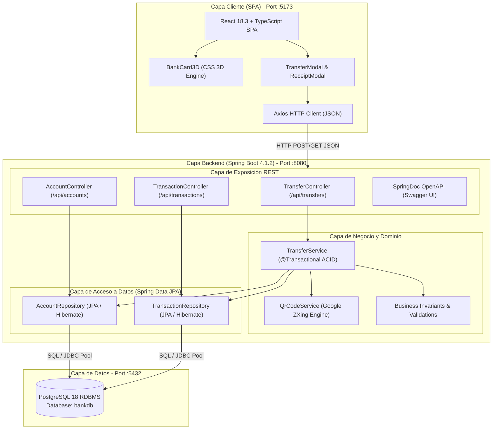
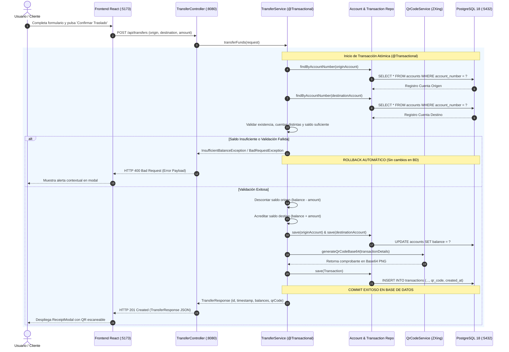
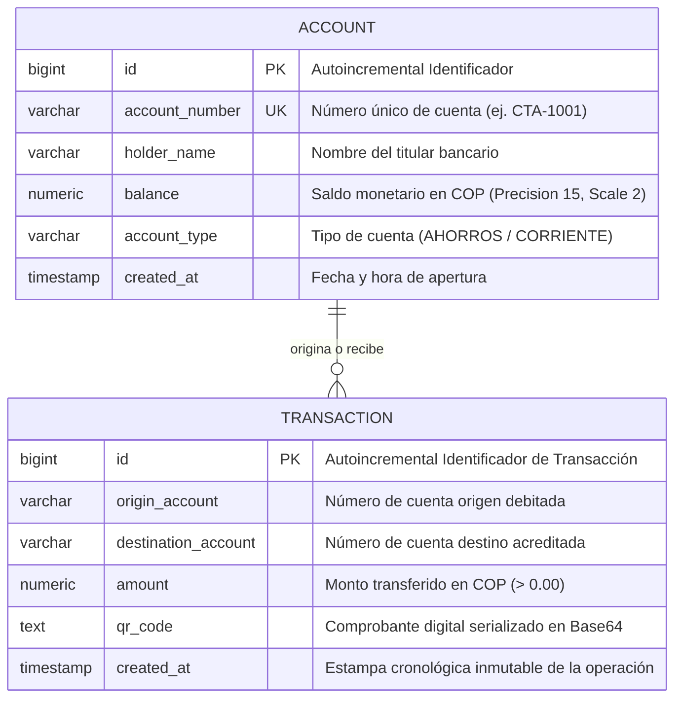
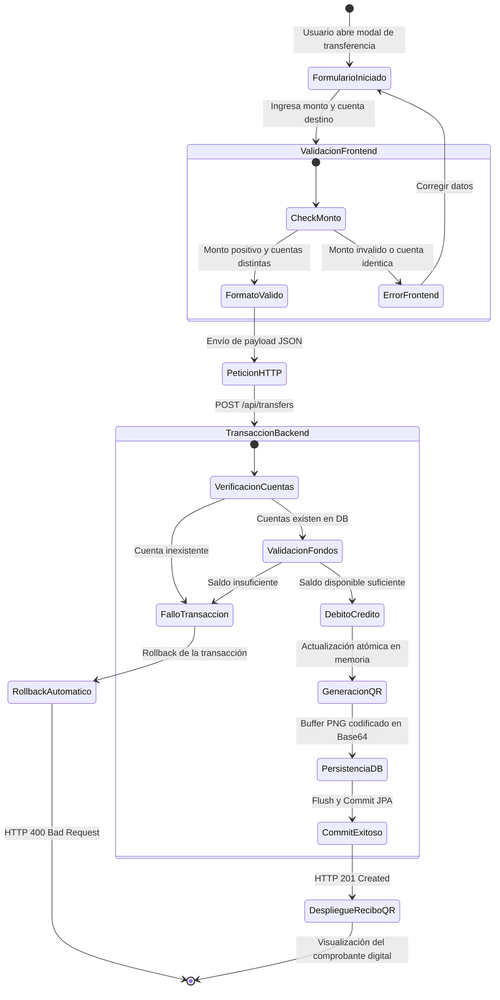

# Laboratorio Spring Boot Banco — Transferencias & Código QR

> **Tecnológico de Antioquia — Institución Universitaria (2026)**
> **Curso:** Diseño de Sistemas
> **Autor:** Brahiam Andres ([@SODI1999](https://github.com/SODI1999))
> **Metodología:** OmniSpec Framework (v0.8.1)
> **Herramientas:** Java 25 LTS (OpenJDK Temurin 25), Spring Boot 4.1.2, PostgreSQL 18, React 18.3.1, Vite 6.0.7, TypeScript 5.7.2, Tailwind CSS 3.4.17, ZXing QR 3.5.3.

---

## 1. Descripción del Proyecto

Aplicación bancaria integral de grado profesional diseñada para gestionar el **traslado atómico de dinero entre cuentas bancarias**, auditar el **histórico de transacciones inmutable** y generar **comprobantes digitales con código QR escaneable** con los datos de cada operación.

El sistema cuenta con:

* **Backend:** API REST desacoplada en Spring Boot 4.1.2 con Java 25 LTS (OpenJDK Temurin 25), persistencia transaccional en PostgreSQL 18, documentación OpenAPI Swagger interactiva y motor de generación de código QR con ZXing.
* **Frontend:** Cliente web moderno en React 18.3.1 + TypeScript 5.7.2 + Vite 6.0.7, con diseño de alta precisión (*Swiss Fintech*), tarjetas financieras táctiles con perspectiva física **CSS 3D interactiva**, tipografía modular con cifras tabulares (`tabular-nums`) y estricto cumplimiento de los **4 estados de interfaz** (*Loading, Empty, Error, Success*).
* **Bitácora de Prompts:** Archivo [PROMPTS.md](PROMPTS.md) con el registro paso a paso de los prompts utilizados para cada capa del sistema según el ciclo de ingeniería y desarrollo.

---

## 2. Stack Tecnológico

### Backend

* **Lenguaje:** Java 25 LTS (OpenJDK Temurin 25.0.4.1, `<java.version>25</java.version>`)
* **Framework:** Spring Boot 4.1.2
* **Persistencia:** Spring Data JPA / Hibernate
* **Base de Datos:** PostgreSQL 18 (puerto local 5432, base de datos `bankdb`)
* **Generación QR:** Google ZXing 3.5.3 (`core` y `javase`)
* **Documentación API:** SpringDoc OpenAPI 2.8.3 (Swagger UI)
* **Herramienta de Build:** Maven Wrapper (`mvnw` / `mvnw.cmd`)
* **Pruebas:** JUnit 5, Mockito

### Frontend

* **Runtime:** Node.js v24.22.1 / npm 11.19.1
* **Librería UI:** React 18.3.1
* **Empaquetador & Dev Server:** Vite 6.0.7
* **Lenguaje:** TypeScript 5.7.2
* **Estilizado:** Tailwind CSS 3.4.17 (diseño artesanal sin plantillas genéricas)
* **Iconografía:** Lucide React 0.474.0
* **Cliente HTTP:** Axios 1.7.9

---

## 3. Arquitectura y Diseño del Sistema

### 3.1. Arquitectura C4 N-Tier (5 Capas de Software)

El sistema implementa una arquitectura en capas desacoplada con aislamiento transaccional y comunicación REST tipada:



---

### 3.2. Diagrama de Secuencia Transaccional (ACID & Rollback Automático)

El flujo de traslado financiero garantiza atomicidad estricta (`ACID`), actualización cruzada de balances y generación de comprobante QR con persistencia previa al commit:



---

### 3.3. Modelo de Datos y Entidad-Relación (ERD)

Estructura de tablas persistidas en PostgreSQL con restricciones de integridad relacional:



---

### 3.4. Diagrama de Estados del Ciclo de Vida Transaccional

Máquina de estados finitos que modela las transiciones desde la entrada de datos hasta el commit o rollback de la operación:



---

### 3.5. Estructura del Repositorio

```
LaboratorioSpringBootBancov2/
├── PROMPTS.md                   # Bitácora formal de prompts paso a paso
├── backend/                     # Servicio Backend Spring Boot 4.1.2 (Java 25 / PostgreSQL 18)
│   ├── pom.xml                  # Configuración de dependencias Maven
│   ├── mvnw / mvnw.cmd          # Maven Wrapper autónomo
│   ├── src/main/java/com/udea/banco/
│   │   ├── BancoApplication.java       # Punto de entrada de la aplicación
│   │   ├── config/                     # CorsConfig, OpenApiConfig, DataInitializer
│   │   ├── controller/                 # TransferController, AccountController, TransactionController
│   │   ├── dto/                        # Records inmutables (TransferRequest, TransferResponse, etc.)
│   │   ├── entity/                     # Entidades JPA (Account, Transaction)
│   │   ├── exception/                  # Excepciones de dominio y GlobalExceptionHandler
│   │   ├── repository/                 # AccountRepository, TransactionRepository
│   │   └── service/                    # TransferService (Transaccional), QrCodeService (ZXing)
│   └── src/main/resources/
│       └── application.properties      # Conexión a PostgreSQL 18
└── frontend/                    # Cliente web React 18/19 + Vite 6 + TypeScript
    ├── src/
    │   ├── components/                 # LoginView, BankCard3D, TransferModal, ReceiptModal, TransactionHistory, Dashboard
    │   ├── services/                   # Cliente Axios (bankApi.ts)
    │   ├── types/                      # Interfaces TypeScript estrictas (bank.ts)
    │   ├── App.tsx                     # Orquestador de vistas y estado
    │   └── index.css                   # Directivas Tailwind y físicas CSS 3D
    └── package.json
```

---

## 4. Endpoints de la API REST

| Método  | Ruta                              | Descripción                                                                                | Código de Respuesta                  |
| :------- | :-------------------------------- | :------------------------------------------------------------------------------------------ | :------------------------------------ |
| `POST` | `/api/transfers`                | Ejecuta un traslado de dinero entre cuentas con validación atómica y genera el código QR | `201 Created` / `400 Bad Request` |
| `GET`  | `/api/accounts`                 | Lista todas las cuentas bancarias con sus titulares y saldos disponibles                    | `200 OK`                            |
| `GET`  | `/api/accounts/{accountNumber}` | Obtiene los detalles y saldo de una cuenta específica                                      | `200 OK` / `404 Not Found`        |
| `GET`  | `/api/transactions`             | Retorna el historial de transacciones ordenado cronológicamente                            | `200 OK`                            |

### Documentación Swagger Interactiva

Con el backend en ejecución, accede a la interfaz interactiva en:
👉 **`http://localhost:8080/swagger-ui.html`**

---

## 5. Cuentas de Prueba Preconfiguradas (`DataInitializer`)

Al iniciar la aplicación por primera vez, el sistema siembra automáticamente las siguientes cuentas de prueba:

| Número de Cuenta      | Titular        | Saldo Inicial (COP) | Tipo de Cuenta |
| :--------------------- | :------------- | :------------------ | :------------- |
| **`CTA-1001`** | Diego Ramirez  | $1.500.000,00       | Ahorros        |
| **`CTA-1002`** | Pedro Gomez    | $500.000,00         | Ahorros        |
| **`CTA-1003`** | Maria Restrepo | $2.800.000,00       | Corriente      |

---

## 6. Instrucciones de Instalación y Ejecución

### Prerrequisitos

* **Java 21 LTS** o superior (ej. OpenJDK Temurin 25 LTS).
* **PostgreSQL 18** ejecutándose en el puerto `5432` con usuario `postgres` y contraseña `postgres` (Base de datos: `bankdb`).
* **Node.js 20+** (probado en v24.22.1) y **npm 11+**.

### Paso 1: Ejecución del Backend (Spring Boot)

En una terminal, ingresa a la carpeta `backend/`:

```bash
cd backend

# Compilar y ejecutar pruebas unitarias
.\mvnw.cmd test

# Iniciar el servidor backend
.\mvnw.cmd spring-boot:run
```

El servidor backend se levantará en: **`http://localhost:8080`**.

### Paso 2: Ejecución del Frontend (React + Vite)

En una terminal separada, ingresa a la carpeta `frontend/`:

```bash
cd frontend

# Instalar dependencias (si no se han instalado)
npm install

# Iniciar el servidor de desarrollo
npm run dev
```

La aplicación web estará disponible en: **`http://localhost:5173`**.

---

## 7. Pruebas Automatizadas

El proyecto cuenta con una batería de pruebas automatizadas que validan los criterios de aceptación (`AC-01` a `AC-09`):

* Atomicidad de la transferencia y actualización de saldos (`TransferServiceTest.testSuccessfulTransfer`).
* Rechazo y rollback cuando la cuenta origen no tiene fondos suficientes (`TransferServiceTest.testInsufficientFunds`).
* Rechazo cuando alguna de las cuentas no existe (`TransferServiceTest.testAccountNotFound`).
* Rechazo cuando la cuenta origen y destino son la misma (`TransferServiceTest.testSameAccountTransfer`).
* Rechazo cuando el monto es menor o igual a cero (`TransferServiceTest.testNonPositiveAmount`).
* Generación de código QR con prefijo Base64 válido (`QrCodeServiceTest.testQrGeneration`).

Para ejecutar las pruebas:

```bash
.\mvnw.cmd test
```

---

## 8. Créditos y Metodología

* **Propósito Académico:** Proyecto desarrollado exclusivamente con fines académicos y de evaluación para el curso de **Diseño de Sistemas (2026)** en el **Tecnológico de Antioquia (TdeA)**, Facultad de Ingeniería.
* **Autor:** **Brahiam Andres ([@SODI1999](https://github.com/SODI1999))**
* **Metodología y Framework:** Construido y gobernado bajo los estándares de ingeniería de software de **OmniSpec** (`omni-spec` v0.8.1), proyecto creado y publicado por el autor bajo **Licencia MIT**.
